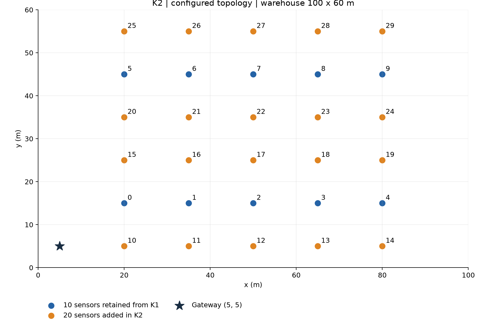
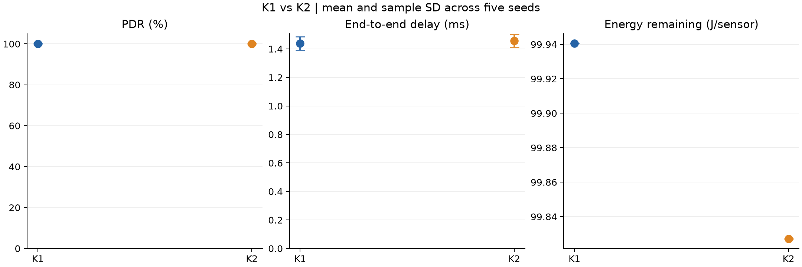
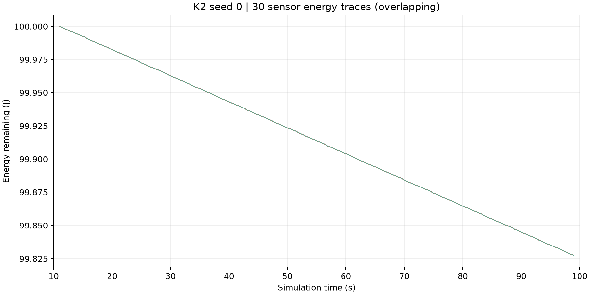

# WarehouseWSN - Kịch bản K2

Nếu mở Analysis đầy đủ bị chậm, dùng `analysis/K2_Energy_Preview.anf`. Bản này dùng file `K2_Energy_Preview.vec` nhẹ đi kèm, giữ đủ 30 sensor của seed 0 với các mẫu thật được lấy thưa (mỗi 100 mẫu và mẫu cuối). Dữ liệu này chỉ phục vụ hiển thị; bảng KPI vẫn tính từ kết quả đầy đủ.

K2 mở rộng K1 của TV1 từ 10 lên 30 sensor, giữ gateway ở góc kho. Project đã chạy thật đủ 5 seed 0–4 trên OMNeT++ 6.4.0 và INET 4.7.0. Kết quả cho thấy PDR vẫn đạt 100%, delay trung bình 1,457106 ms và năng lượng còn lại 99,827201 J/sensor.

## 1. Kế thừa K1

Nguồn: [OMNET__INET, commit 4202f68](https://github.com/hynGithub062004/OMNET__INET/tree/4202f68/K1/WarehouseWSN).

- Giữ tên project `WarehouseWSN`, network `warehousewsn.simulations.WarehouseWSN`, tên module `sensor[]`, `gateway` và các file `WarehouseWSN.ned`, `package.ned`, `omnetpp.ini`, `Makefile`.
- Hai file NED và phần cấu hình K1 trong `omnetpp.ini` được giữ nguyên từ upstream. K2 được nối thêm vào cùng file: `[Config K2_Final]` có `extends = K1_Final`.
- Giữ các metadata IDE của K1, gồm `.project`, `.cproject`, `.nedfolders`, `.nedexclusions`, `.oppbuildspec`.
- Tên tài liệu và Analysis đổi tiền tố theo kịch bản: `README_K2.md`, `K2_Energy_Analysis.anf`, `K2_Final-0.sca` đến `K2_Final-4.sca`.
- K1 trong repository được giữ nguyên. K2 có đầy đủ định nghĩa K1 để import và chạy độc lập, không cần include qua một project K1 khác.

```text
K2/WarehouseWSN/
├── .project, .cproject, .nedfolders, .nedexclusions, .oppbuildspec
├── .gitignore
├── Makefile
├── README_K2.md
├── run_k2.ps1
├── simulations/
│   ├── WarehouseWSN.ned
│   ├── package.ned
│   ├── omnetpp.ini
│   └── results/
│       ├── K2_Final-0.sca ... K2_Final-4.sca
│       └── K2_Final-0.vec ... K2_Final-4.vec
└── analysis/
    ├── K2_Energy_Analysis.anf
    ├── analyze_results.py
    ├── K2_all_seeds.log
    └── exports/
        ├── K1_K2_per_seed.csv
        ├── K1_K2_summary.csv
        ├── K1_K2_energy_per_sensor.csv
        ├── K1_K2_results.md
        ├── K2_coordinates.csv
        ├── K2_vector_checks.csv
        ├── K1_K2_KPI.png
        ├── K2_Topology.png
        └── K2_Energy_Remaining.png
```

`*.vec` và `*.vci` tiếp tục được Git bỏ qua theo quy tắc K1 vì dung lượng lớn; chúng có trong kết quả chạy tại máy và gói ZIP bàn giao. Scalar, CSV và hình PNG có thể đưa lên Git.

## 2. Thiết kế đối chứng theo dàn ý báo cáo

Phép so sánh K1–K2 khảo sát việc bổ sung sensor trong cùng diện tích. Gateway và toàn bộ tham số vận hành của các node cũ được giữ nguyên. Các node mới dùng cùng cấu hình wildcard của K1.

| Tham số | K1 | K2 |
|---|---|---|
| Số sensor | 10 | 30 |
| Kho | 100 × 60 m | Giữ nguyên |
| Gateway | (5, 5, 0) m | Giữ nguyên |
| Sensor 0–9 | Tọa độ K1 | Giữ nguyên từng tọa độ |
| Mobility | StationaryMobility | Giữ nguyên |
| Truyền dữ liệu | UDP single-hop, forwarding=false | Giữ nguyên |
| Ứng dụng | UdpBasicApp → UdpSink | Giữ nguyên |
| Đích và cổng | gateway, UDP 5000 | Giữ nguyên |
| Payload ứng dụng | 64 B | Giữ nguyên |
| Chu kỳ gửi | 1 s/sensor | Giữ nguyên |
| Start và stop | uniform(11 s, 12 s), 99 s | Giữ nguyên quy tắc |
| MAC | CsmaCaMac, ACK=true | Giữ nguyên |
| ACK timeout | 300 µs | Giữ nguyên |
| Retry limit | 7, mặc định INET đã kiểm tra từ scalar | Giữ nguyên |
| Backoff | cwMin=31, cwMax=1023, slot=20 µs, SIFS=10 µs | Giữ nguyên |
| Hàng đợi | DropTailQueue, 50 packet | Giữ nguyên |
| Radio | GenericRadio, unitDisk, xét interference | Giữ nguyên |
| Bitrate | 1 Mbps | Giữ nguyên |
| Communication và interference range | 100 m và 120 m | Giữ nguyên |
| Background noise | -110 dBm | Giữ nguyên |
| Energy storage | SimpleEpEnergyStorage, ban đầu 100 J | Giữ nguyên |
| Energy consumer | SensorStateBasedEpEnergyConsumer | Giữ nguyên cả mặc định INET |
| Thời gian chạy và warm-up | 100 s và 10 s | Giữ nguyên |
| Replication và seed-set | 5, seed = repetition = 0–4 | Giữ nguyên |
| Offered load payload khi gửi định kỳ | 5.120 bit/s | 15.360 bit/s |

`unitDisk` mô hình hóa liên kết bằng các ngưỡng khoảng cách. Không thay nó bằng radio 802.15.4, không thêm fading hoặc đổi công suất để tạo khác biệt KPI. CsmaCaMac là mô hình CSMA/CA của INET, không được diễn giải là một triển khai IEEE 802.15.4 đầy đủ.

## 3. Tọa độ 30 sensor

Trong mỗi hàng, X lần lượt bằng 20, 35, 50, 65, 80 m; Z của mọi node bằng 0 m.

| Nhóm node theo thứ tự X | Y (m) | Nguồn |
|---|---:|---|
| sensor[0]–sensor[4] | 15 | Giữ từ K1 |
| sensor[5]–sensor[9] | 45 | Giữ từ K1 |
| sensor[10]–sensor[14] | 8 | Bổ sung |
| sensor[15]–sensor[19] | 25 | Bổ sung |
| sensor[20]–sensor[24] | 35 | Bổ sung |
| sensor[25]–sensor[29] | 52 | Bổ sung |

Kết quả là lưới 5 cột × 6 hàng, khoảng cách cột 15 m. Hai hàng ngoài Y=8 và 52 m giữ cách bố trí trong project K2 có sẵn tại máy người dùng; các hàng còn lại ở Y=15, 25, 35 và 45 m. Không có hai sensor trùng tọa độ. Gateway vẫn tại (5, 5). Sensor xa nhất cách gateway khoảng 88,51 m, nằm trong communication range 100 m. File `analysis/exports/K2_coordinates.csv` lấy từ tham số đã resolve trong scalar, có thể dùng nguyên bộ tọa độ này để triển khai K3 sau này.



Đây là sơ đồ tọa độ dựng từ dữ liệu cấu hình đã chạy, không phải ảnh chụp Qtenv. Để quan sát topology và packet flow trong IDE, dùng `K2_Visual`.

## 4. Cách import và chạy

### OMNeT++ IDE

1. Dùng OMNeT++ 6.4.0, import và build INET 4.7.0 ở release mode.
2. Vì giữ tên `WarehouseWSN` như K1, dùng workspace IDE riêng cho K2 nếu workspace hiện tại đã có project K1 tên đó. Import INET và `K2/WarehouseWSN` vào workspace mới. Không import đồng thời hai `.project` cùng tên.
3. Kiểm tra Project References trỏ đến `inet-4.7.0`. Khi build bằng IDE, cho IDE sinh lại Makefile theo vị trí INET thực tế. Makefile kế thừa K1 giả định INET nằm ở `../inet-4.7.0` so với project.
4. Chọn `opp_run`, working directory `/WarehouseWSN/simulations`, ini `omnetpp.ini`, config `K2_Final`, giao diện Cmdenv và **All runs** để chạy đủ #0–#4. Chỉ bấm chạy một run sẽ không tự tạo đủ 5 kết quả.
5. Muốn xem topology/packet flow, chọn `K2_Visual`, Qtenv, run #0. Traffic bắt đầu sau giây 11. Kết quả quan sát dùng tiền tố riêng `K2_Visual`, không ghi đè `K2_Final`.

Project chỉ dùng module INET có sẵn nên có thể chạy trực tiếp bằng `opp_run` với thư viện INET đã build, không cần biên dịch thêm C++ riêng cho K2.

### PowerShell trên máy hiện tại

Mở PowerShell tại `K2/WarehouseWSN`:

```powershell
.\run_k2.ps1 `
  -OmnetRoot 'D:\Apps\omnet++\omnetpp-6.4.0-windows-x86_64\omnetpp-6.4.0' `
  -InetRoot 'D:\Apps\omnet++\omnetpp-6.4.0-windows-x86_64\omnetpp-6.4.0\samples\inet-4.7.0'
```

Script chạy đủ seed 0–4, tự thiết lập PATH trong tiến trình hiện tại, nạp `.nedexclusions` của INET và kiểm tra mã thoát. Có thể truyền `-Runs '2..4'` để chỉ chạy các run còn thiếu. Đổi hai đường dẫn khi chuyển sang máy khác.

### Project đã tích hợp trên máy này

Đường dẫn: `D:\Apps\omnet++\omnetpp-6.4.0-windows-x86_64\omnetpp-6.4.0\samples\WarehouseWSN`.

`simulations/omnetpp.ini` đã được cập nhật để K2 kế thừa K1. File NED, cách hiển thị, metadata IDE và executable hiện có được giữ nguyên. Cấu hình nguồn trước khi cập nhật nằm trong `backups/before_K2_20261029`. Hai hàng Y=8 và 52 m và tên config `K2_Base` từ bản nháp được giữ lại; `K2_Base` hiện là alias của `K2_Final` để tránh hỏng lựa chọn config cũ. Trong project tích hợp, không cần import lại project có cùng tên; bấm Refresh trong IDE và chọn `K2_Final`.

Để quan sát bằng Qtenv:

```powershell
.\run_k2.ps1 -OmnetRoot '<thu muc OMNeT++>' -InetRoot '<thu muc INET>' -Configuration K2_Visual -Ui Qtenv
```

## 5. Thu thập và tính KPI

Ba KPI chính bám dàn ý báo cáo: PDR, End-to-End Delay, Energy Remaining. Goodput payload được bổ sung làm chỉ số hỗ trợ về capacity; đây cũng là dữ liệu cho yêu cầu ít nhất 4 chỉ số trong PDF thực hành. Retry và frame nhận không gửi cho mình chỉ dùng giải thích kết quả.

| Chỉ số | Dữ liệu và phương pháp |
|---|---|
| Packet Sent | Tổng `sensor[i].app[0].packetSent:count`, chỉ ở tầng ứng dụng |
| Packet Received | `gateway.app[0].packetReceived:count`, cùng tầng |
| PDR | 100 × Received / Sent, tính từng seed trước khi tổng hợp |
| Delay | `gateway.app[0].endToEndDelay:stats`, mean × 1.000 để đổi s → ms; chỉ các gói nhận thành công |
| Energy Remaining | `sensor[i].energyStorage.residualEnergyCapacity:last`; trung bình sensor trong từng seed, sau đó tổng hợp 5 seed |
| Energy Consumption | 100 J trừ Energy Remaining, dùng hỗ trợ |
| Goodput payload | Received × 64 B × 8 / 90 s, cửa sổ đo [10, 100] s |
| Retry | Tổng `wlan[0].mac.numRetry` của sensor và gateway |
| Frame nhận không gửi cho mình | Trung bình `sensor[i].wlan[0].mac.packetDropNotAddressedToUs:count` |

Mỗi sensor gửi 88 packet/run nên K2 tạo 30 × 88 = 2.640 packet/run. Offered load định kỳ 15.360 bit/s khác goodput trung bình trên cửa sổ đo do ứng dụng bắt đầu sau warm-up và dừng trước giây 100.

`last` là mẫu năng lượng được ghi cuối cùng, không nhất thiết tại đúng t=100 s. Giữ định nghĩa này để nhất quán K1; thời điểm cuối của từng vector có trong `K2_vector_checks.csv`. Mô hình năng lượng chỉ tính radio theo các trạng thái INET, chưa có mô hình riêng cho CPU và bộ phận đo nhiệt độ/độ ẩm.

Scalar lưu số đếm và thống kê tổng hợp. Vector lưu delay từng gói, năng lượng và công suất theo thời gian. File Analysis giữ cách tổ chức của K1, đổi input sang K2, mặc định chỉ hiển thị năng lượng seed 0 để tránh trộn 150 đường của 5 seed. Có thể đổi bộ lọc `repetition` để xem seed khác.

### Tái tạo bảng và hình

Mở terminal tại project, dùng Python 3.10 trở lên:

```powershell
python analysis/analyze_results.py
```

Lệnh mặc định chỉ dùng thư viện chuẩn, cần đủ 5 scalar K1 tại `../../K1/WarehouseWSN/simulations/results` và đủ 5 scalar K2 tại `simulations/results`. Khi tích hợp vào project có sẵn trong thư mục samples, baseline K1 được đặt tại `analysis/baseline_K1` và chương trình tự chọn vị trí này nếu không có cấu trúc repository K1/K2. Nếu dữ liệu ở nơi khác, truyền `--k1 '<thu muc scalar K1>' --k2 '<thu muc scalar K2>'`.

Để kiểm tra toàn bộ vector và vẽ lại bằng matplotlib:

```powershell
python -m pip install matplotlib
python analysis/analyze_results.py --plots --verify-vectors
```

Chương trình từ chối thiếu seed, sai config, thiếu sensor, packet count bất thường, delay không hợp lệ, thiếu counter MAC và received > sent. Trường hợp received > sent phải kiểm tra duplicate vì CsmaCaMac không có duplicate suppression, không được ép PDR về 100%. Chương trình so sánh tham số đã resolve giữa K1 và K2 theo từng seed, bao gồm mặc định INET, bỏ qua địa chỉ tự sinh và hiển thị. Khi bật `--verify-vectors`, kiểm tra 150 chuỗi năng lượng không tăng, 5 chuỗi delay không âm và sự khớp giữa vector với scalar.

## 6. Kết quả thực nghiệm cho mục 2.7.2

5 run K2 đã kết thúc tại t=100 s, có log kiểm chứng. Dữ liệu K1 lấy trực tiếp từ 5 file `K1_Final-*.sca` của upstream; không chạy lại hoặc sửa kết quả K1.

| Seed | Sent | Received | PDR (%) | Delay mean (ms) | Energy mean (J/sensor) |
|---|---:|---:|---:|---:|---:|
| 0 | 2.640 | 2.640 | 100 | 1,431717 | 99,827200576 |
| 1 | 2.640 | 2.640 | 100 | 1,470728 | 99,827200399 |
| 2 | 2.640 | 2.640 | 100 | 1,521717 | 99,827200653 |
| 3 | 2.640 | 2.640 | 100 | 1,402484 | 99,827200911 |
| 4 | 2.640 | 2.640 | 100 | 1,458882 | 99,827200478 |

Giá trị ± là **độ lệch chuẩn mẫu giữa 5 seed**, không phải khoảng tin cậy 95%.

| Chỉ số | K1 | K2 |
|---|---:|---:|
| PDR (%) | 100 ± 0 | 100 ± 0 |
| Delay mean (ms) | 1,439329 ± 0,047127 | 1,457106 ± 0,044697 |
| Energy Remaining (J/sensor) | 99,940533389 ± 0,000000290 | 99,827200603 ± 0,000000197 |
| Energy Consumption (J/sensor) | 0,059466611 | 0,172799397 |
| Goodput payload (bit/s) | 5.006,222 | 15.018,667 |
| MAC retry/run | 0 | 0 |
| MAC given-up/run | 0 | 0 |
| Frame không gửi cho mình/sensor/run | 792 | 2.552 |





Các đường năng lượng của 30 sensor gần như trùng nhau ở cấu hình này. Số liệu chi tiết từng sensor nằm trong CSV; không suy luận thiếu node từ các đường bị chồng lên nhau trên hình.

## 7. Phân tích cho mục 2.8.1 và giới hạn cho mục 2.9

**Độ tin cậy:** tăng từ 10 lên 30 sensor làm số gói gửi tăng đúng 3 lần, trong khi PDR vẫn 100% trên cả 5 seed. Không có packet loss, retry hay given-up trong thí nghiệm này. Chưa có bằng chứng mạng bị quá tải; không diễn giải giả thuyết tranh chấp tăng thành một kết quả đã được chứng minh.

**Độ trễ:** mean tăng khoảng 0,017777 ms, tương đương 1,24%. Mức chênh lệch nhỏ so với dao động giữa seed, nên không khẳng định khác biệt có ý nghĩa thống kê khi chưa làm kiểm định. Cả 5 delay mean K2 đều thấp hơn ngưỡng 120 ms được nêu trong dàn ý; không tự gán thêm ngưỡng PDR hoặc dung lượng pin đạt/không đạt.

**Năng lượng:** năng lượng còn lại giảm khoảng 0,113333 J/sensor. Năng lượng tiêu thụ trung bình tăng khoảng 2,91 lần; 10 sensor cũ cũng có cùng mức giảm này. Bộ đếm MAC cho thấy mỗi sensor loại bỏ 2.552 frame không gửi cho mình trong K2, so với 792 ở K1; con số bằng số frame dữ liệu của các sensor còn lại, 29 × 88 so với 9 × 88. Đây là bằng chứng về overhearing trong mô hình, phù hợp với việc tăng thời gian radio nhận dữ liệu của node khác. Do retry bằng 0, không quy mức tăng tiêu thụ cho truyền lại.

**Capacity và phạm vi kết luận:** offered load payload chỉ chiếm khoảng 1,536% bitrate 1 Mbps, chưa tính overhead MAC/PHY. Tất cả sensor nằm trong range của gateway và trong vùng nghe lẫn nhau. Kết quả cho thấy cấu hình 30 node hiện tại đáp ứng tốt tải đang xét, không chứng minh khả năng mở rộng vô hạn hoặc hiệu quả ngoài kho thật.

Mô hình chưa có kệ kim loại, fading, shadowing, duty cycling, CPU energy hoặc đo kiểm thiết bị thật. Không suy ra lifetime từ lần chạy 100 s với pin còn nhiều. Với unitDisk và range hiện tại, chuyển gateway vào giữa trong K3 có thể chỉ tạo thay đổi nhỏ; cần giữ nguyên 30 tọa độ K2 và chạy cùng seed để xác định thay đổi thực tế. K2 không tự thay mô hình truyền để tạo ra một kết quả khác K1.

## 8. Nguồn và kiểm chứng

- Dàn ý người dùng cung cấp: `WSN_2_chapter_v2_3_chi_so.docx`, các mục 1.6.2, 2.3.2, 2.5–2.9.
- Tài liệu thực hành: `OMNeTpp_INET_WSN_ThucHanh_BTL.pdf`, trang PDF 47, 50 và 51 về kho hàng, chỉ số và đối chứng.
- [CsmaCaMac của INET 4.7.0](https://github.com/inet-framework/inet/blob/v4.7.0/src/inet/linklayer/csmaca/CsmaCaMac.ned): ACK, retry limit, backoff và giới hạn duplicate suppression.
- [UdpSink của INET 4.7.0](https://github.com/inet-framework/inet/blob/v4.7.0/src/inet/applications/udpapp/UdpSink.ned): statistic packetReceived và endToEndDelay.
- Các tham số thực tế của radio và năng lượng được kiểm tra trực tiếp từ scalar K1 và K2, không dùng giá trị mẫu thay số liệu chạy thật.
